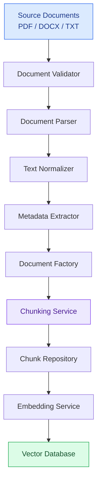
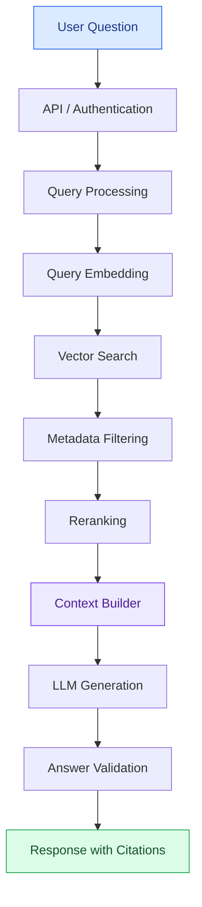

# Production-Oriented RAG — Architecture

**Project:** `production-rag`  
**Version:** 0.3  
**Status:** Initial architecture — ingestion and chunking implemented as learning milestones

---

## 1. Purpose

This document describes the architecture of the Production-Oriented RAG system.

The objective is to build an enterprise-ready Retrieval-Augmented Generation (RAG) platform that allows users to retrieve accurate, relevant, and traceable information from organizational documents.

The system will support documents such as:

- Customer contracts
- HR policies
- Technical documentation
- Operational procedures
- Product manuals
- Internal knowledge articles

The architecture follows a modular design, separating document ingestion, chunking, embedding, indexing, retrieval, generation, and evaluation.

## 2. Business Problem

Organizations store large amounts of information in documents and knowledge repositories.

Users need to ask questions such as:

- What are the termination conditions in contract #4821?
- What is the company's refund policy?
- How many days of notice are required?
- What are the procedures for handling a technical incident?

Traditional keyword search may not understand the meaning or context of a question.

An LLM alone may not have access to private organizational information and can generate unsupported answers.

The RAG architecture addresses this problem by retrieving relevant organizational information and providing it as context to an LLM.

## 3. Architecture Principles

The system follows these principles:

1. Separation of concerns.
2. Modular and independently testable components.
3. Document and chunk provenance.
4. Configurable processing pipelines.
5. Explicit metadata management.
6. Secure document access.
7. Traceable answers with citations.
8. Evaluation-driven quality improvements.
9. Observable and measurable execution.
10. Replaceable infrastructure components.

## 4. High-Level Architecture

The system contains two main pipelines:

- Indexing pipeline: prepares organizational documents for retrieval.
- Query pipeline: retrieves relevant information and generates answers.

### 4.1 Indexing Pipeline

The indexing pipeline processes source documents and prepares them for vector search.



### 4.2 Query Pipeline

The query pipeline retrieves relevant chunks and uses them to generate grounded answers.



## 5. Core Components

### 5.1 Document Ingestion

**Responsibility:** Validate and extract content from source documents.

Components:

| Component | Responsibility |
|---|---|
| Document Validator | Validate file existence, type, and size |
| Document Parser | Extract text from PDF, DOCX, and TXT |
| Text Normalizer | Normalize extracted text |
| Metadata Extractor | Extract document metadata |
| Document Factory | Create standardized Document objects |
| Ingestion Service | Orchestrate ingestion |

Input:
- Original document file.

Output:
- Standardized Document object.

Current implementation:

- `src/rag/ingestion/validator.py`
- `src/rag/ingestion/parser.py`
- `src/rag/ingestion/normalizer.py`
- `src/rag/ingestion/metadata.py`
- `src/rag/ingestion/service.py`
- `src/rag/models/document.py`

### 5.2 Chunking Engineering

**Responsibility:** Transform documents into smaller, retrievable units.

Components:

| Component | Responsibility |
|---|---|
| Chunking Config | Define chunk size and overlap |
| Recursive Splitter | Split text using structural separators |
| Chunking Service | Orchestrate document chunking |
| Chunk Model | Preserve content and provenance |

Initial strategy:

- Recursive character splitting.
- Configurable chunk size.
- Configurable overlap.
- Character offset tracking.
- Document metadata propagation.

Initial configuration:

| Parameter | Value |
|---|---:|
| Chunk size | 1,000 characters |
| Chunk overlap | 150 characters |
| Minimum boundary ratio | 0.5 |

These are experimental starting values, not fixed production settings.

Current implementation:

- `src/rag/models/chunk.py`
- `src/rag/chunking/config.py`
- `src/rag/chunking/recursive.py`
- `src/rag/chunking/service.py`

### 5.3 Embedding Service

**Responsibility:** Convert document chunks and user queries into numerical vectors.

Planned responsibilities:

- Integrate an embedding model.
- Generate embeddings for document chunks.
- Generate embeddings for user queries.
- Support batch processing.
- Validate vector dimensions.
- Handle API errors and retries.
- Track token usage and embedding costs.

Status: Planned.

### 5.4 Vector Database

**Responsibility:** Store and retrieve embeddings.

Planned technology:

- PostgreSQL
- pgvector

Responsibilities:

- Store vectors.
- Store chunk metadata.
- Perform similarity search.
- Filter by document metadata.
- Support document and index versioning.

Status: Planned.

### 5.5 Retrieval Service

**Responsibility:** Retrieve relevant chunks for a user query.

Planned capabilities:

- Vector similarity search.
- Top-K retrieval.
- Metadata filtering.
- Hybrid search.
- Retrieval score handling.
- Reranking.

Status: Planned.

### 5.6 Context Builder

**Responsibility:** Construct the context supplied to the LLM.

Responsibilities:

- Select relevant chunks.
- Remove duplicate content.
- Preserve source references.
- Respect the model context window.
- Organize retrieved information.
- Prepare citation metadata.

Status: Planned.

### 5.7 Generation Service

**Responsibility:** Generate answers grounded in retrieved information.

Planned capabilities:

- LLM API integration.
- Prompt templates.
- Structured output.
- Citation generation.
- Insufficient-evidence handling.
- Response validation.

Status: Planned.

### 5.8 Evaluation Service

**Responsibility:** Measure RAG system quality.

Planned evaluation dimensions:

- Retrieval precision.
- Retrieval recall.
- Context relevance.
- Faithfulness.
- Answer relevance.
- Citation correctness.
- Latency and cost.

Status: Planned.

## 6. Domain Models

### 6.1 Document

A Document represents the normalized content extracted from an original source file.

```python
@dataclass
class Document:
    document_id: str
    filename: str
    file_type: str
    content: str
    metadata: dict
```

### 6.2 Chunk

A Chunk represents a segment of a document.

```python
@dataclass
class Chunk:
    chunk_id: str
    document_id: str
    chunk_index: int
    content: str
    start_char: int
    end_char: int
    metadata: dict
```

### 6.3 Future domain models

Additional models will be introduced as the system evolves:

- Embedding
- RetrievalResult
- Query
- RetrievedContext
- RAGResponse
- Citation
- EvaluationResult

## 7. Data Flow

### 7.1 Document Processing

Example:

1. User uploads `contract-4821.pdf`.
2. Validator checks the file.
3. PDF parser extracts text.
4. Normalizer cleans extracted content.
5. Metadata extractor records source information.
6. Ingestion service creates a Document.
7. Chunking service splits the Document.
8. Embedding service generates vectors.
9. Vector database stores vectors and metadata.

### 7.2 Query Processing

Example question:

"What are the termination conditions in customer contract #4821?"

Expected execution:

1. Authenticate the user.
2. Validate access to contract #4821.
3. Process the question.
4. Generate query embedding.
5. Retrieve relevant chunks.
6. Apply metadata and authorization filters.
7. Rerank retrieved results.
8. Build the context.
9. Send the question and context to the LLM.
10. Validate the answer and citations.
11. Return the answer with source references.

## 8. Data Storage Architecture

The architecture distinguishes between original documents, processed chunks, and vector representations.

| Storage | Purpose | Planned technology |
|---|---|---|
| Original document storage | Retain uploaded files | Local storage initially; object storage later |
| Processed document store | Retain normalized content and metadata | PostgreSQL |
| Chunk storage | Retain chunk text and provenance | PostgreSQL |
| Vector storage | Store and search embeddings | PostgreSQL + pgvector |

The original document remains the source of truth. The vector index is a searchable representation of its content and should be rebuildable.

## 9. Security Architecture

Security must be enforced throughout both pipelines.

Planned controls:

- API authentication.
- Role-based access control.
- Document-level authorization.
- Tenant isolation.
- Secure file upload validation.
- Malware scanning.
- Secrets management.
- Encryption in transit and at rest.
- Prompt injection defenses.
- Sensitive information handling.
- Audit logging.

Important rule:

Authorization filtering must happen before retrieved content is passed to the LLM. The model must not receive documents the requesting user is not permitted to access.

## 10. Reliability and Error Handling

Planned controls:

- File validation errors.
- Parser failures.
- Empty extraction detection.
- Embedding API retries.
- Rate-limit handling.
- Vector database failures.
- Timeout management.
- Duplicate document detection.
- Idempotent ingestion.
- Document versioning.
- Dead-letter handling for failed asynchronous jobs.

A failed document ingestion should not silently produce an incomplete or invalid index.

## 11. Observability

The system will eventually expose:

- Ingestion success and failure rates.
- Parsing duration.
- Chunk count per document.
- Embedding latency and token usage.
- Vector search latency.
- Retrieved chunk counts.
- Generation latency.
- Token usage and cost.
- Evaluation scores.
- Error rates.

Planned technologies:

- Python logging
- OpenTelemetry
- Langfuse

## 12. Technology Stack

| Layer | Technology |
|---|---|
| Language | Python |
| Package manager | uv |
| API | FastAPI |
| LLM | OpenAI API |
| Embeddings | OpenAI embedding models |
| Vector database | PostgreSQL + pgvector |
| Testing | pytest |
| Linting | Ruff |
| Containerization | Docker |
| Evaluation | Custom evaluation + RAGAS |
| Observability | OpenTelemetry + Langfuse |

Frameworks such as LangChain and LangGraph will be introduced later, after the core RAG lifecycle has been implemented in plain Python.

## 13. Project Structure

```text
production-rag/
├── README.md
├── CHANGELOG.md
├── pyproject.toml
│
├── data/
│   ├── contracts/
│   ├── policies/
│   └── procedures/
│
├── docs/
│   ├── architecture.md
│   ├── architecture.mmd
│   ├── rag-lifecycle.md
│   ├── day-01-notes.md
│   ├── day-02-notes.md
│   └── day-03-notes.md
│
├── src/
│   └── rag/
│       ├── __init__.py
│       ├── main.py
│       │
│       ├── models/
│       │   ├── __init__.py
│       │   ├── document.py
│       │   └── chunk.py
│       │
│       ├── ingestion/
│       │   ├── __init__.py
│       │   ├── validator.py
│       │   ├── parser.py
│       │   ├── normalizer.py
│       │   ├── metadata.py
│       │   └── service.py
│       │
│       └── chunking/
│           ├── __init__.py
│           ├── config.py
│           ├── recursive.py
│           └── service.py
│
└── tests/
    ├── ingestion/
    │   ├── test_validator.py
    │   ├── test_parser.py
    │   ├── test_normalizer.py
    │   └── test_service.py
    │
    └── chunking/
        ├── test_config.py
        ├── test_recursive.py
        └── test_service.py
```

## 14. Implementation Roadmap

| Milestone | Capability | Status |
|---|---|---|
| Day 1 | RAG foundations and architecture | Completed |
| Day 2 | Document ingestion | Implemented as learning baseline |
| Day 3 | Chunking engineering | Implemented as learning baseline |
| Day 4 | Embeddings engineering | Planned |
| Day 5 | Vector database integration | Planned |
| Day 6 | Retrieval engineering | Planned |
| Day 7 | Reranking | Planned |
| Day 8 | Generation engineering | Planned |
| Day 9 | Advanced RAG | Planned |
| Day 10 | RAG evaluation | Planned |
| Day 11 | RAG security | Planned |
| Day 12 | RAG observability | Planned |
| Day 13 | Performance engineering | Planned |
| Day 14 | Production deployment | Planned |
| Day 15 | Enterprise RAG | Planned |

## 15. Architecture Decisions

| Decision | Choice | Reason |
|---|---|---|
| Implementation approach | Plain Python first | Understand core engineering concepts |
| Ingestion architecture | Modular pipeline | Independent testing and maintenance |
| Document representation | Document domain model | Standardized input to downstream components |
| Chunk representation | Chunk domain model | Preserve provenance |
| Initial chunking strategy | Recursive character | Practical general-purpose baseline |
| Initial vector database | PostgreSQL + pgvector | Relational metadata and vector search |
| Progress tracking | CHANGELOG.md | Version-controlled learning and project history |
| Testing | pytest | Automated quality checks |
| Framework adoption | Later | Avoid hiding core RAG concepts behind abstractions |

## 16. Current Architecture Limitations

The current implementation is a learning baseline, not yet a production-ready enterprise platform.

Known limitations:

- No token-aware chunking.
- No page-level PDF provenance.
- DOCX tables are not yet extracted.
- No OCR for scanned PDFs.
- No semantic chunking.
- No embeddings or vector database.
- No authorization enforcement.
- No asynchronous ingestion.
- No document versioning.
- No retrieval or answer evaluation.

These capabilities will be introduced incrementally and reflected in this document as the architecture evolves.

---

**Architecture status:** Ingestion and initial chunking implemented as learning milestones. Embedding, indexing, retrieval, generation, and production controls remain planned.

**Next milestone:** Day 4 — Embeddings Engineering.
